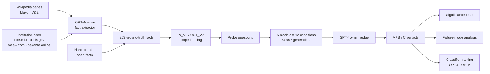
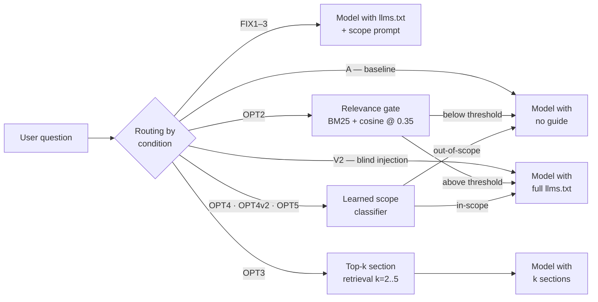
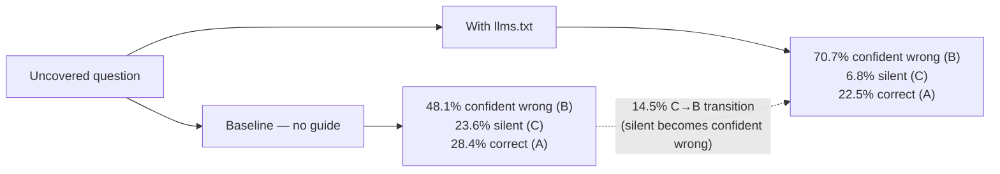

# BurnettBench — Study 2

**Scope Coverage Effects in llms.txt V2 — Replication Package**

Happy Herman Niyorurema · Maricar Hastings Estella (Research Supervisor)
Department of Communications and Strategy, Anne Burnett Marion School of Medicine, TCU
October 2026

---

## What this is

BurnettBench Study 2 measures what happens when an AI is given an `llms.txt` V2 guide that does not fully cover all possible questions about an institution. We tested **5 institutions, 5 AI models, and 263 ground-truth facts** across 12 experimental conditions, using GPT-4o-mini as an automated accuracy judge.

**Main finding:** giving the AI an incomplete guide *reduces* accuracy on facts the guide does not cover — and the failure mode is confident wrong answers, not hedging.

| Finding | Value |
|---|---|
| IN_V2 accuracy lift (A → V2) | **+60.6pp**, p<.001 |
| OUT_V2 accuracy harm (A → V2) | **−6.4pp**, p=0.001 |
| OPT2 (query-time gating) OUT_V2 vs A | −5.0pp, p=0.0098 |
| Injection paradox (C→B transition) | 14.5% of matched pairs |
| Real file harm (Bakame OUT) | **−12.5pp** |
| Human–judge agreement (majority-vote κ) | **0.570** (moderate) |
| In-family judge bias (GPT vs Llama κ gap) | **~0.25 κ** |

Full report:
- [`burnettbench_technical_report.pdf`](burnettbench_technical_report.pdf) — printable, ~1.4 MB
- [`burnettbench_technical_report.html`](burnettbench_technical_report.html) — self-contained, open in any browser

## Study pipeline

How the data moves from public sources through the benchmark to the final verdicts:



## Experimental conditions

The 12 conditions differ in **how** the `llms.txt` guide is delivered to the model — from no guide at all, to full injection, to several forms of query-time filtering:



## The injection paradox

Why giving the model a guide can make it *more* confidently wrong, not just marginally less accurate, on uncovered facts:



## Repository layout

```
burnettbench/
├── README.md                           ← this file
├── README.html                         ← original packaged README
├── burnettbench_technical_report.html  ← full technical report (HTML)
├── burnettbench_technical_report.pdf   ← full technical report (PDF)
├── LICENSE                             ← MIT (code) / CC-BY-4.0 (data)
├── guides/     ← llms.txt V2 guide documents (5 synthetic + 1 real)
├── probes/     ← ground-truth facts and probe questions
├── results/    ← all experiment verdicts and raw results
├── scripts/    ← Python scripts (eval, train, analyze)
├── assets/     ← SVG diagram sources
└── study1/     ← prior work this study extends
```

**Trained DistilBERT classifier checkpoints (`.pt`, ~2 GB)** are not in this repo. They live on Hugging Face:

> https://huggingface.co/hniyorurema/burnettbench-scope-classifiers

**Human-validation dataset** (300 items × 1,000 anonymized ratings, G1–G5, plus blind GPT-4o-mini judge verdicts) is published separately as a standalone 🤗 dataset:

> https://huggingface.co/datasets/hniyorurema/burnettbench-human-validation

Grader web app source: https://github.com/happy-tcu/burnettbench-grader

## Reproducing the headline numbers

The shipped verdict files are the authoritative artifacts — the numbers in the paper come from them directly. You can reproduce the per-institution lifts in seconds, no API calls needed:

```python
import json
inst_order = ['bakame', 'mayo', 've', 'uscis', 'rice']
for inst in inst_order:
    data = [json.loads(l) for l in open(f'results/burnettbench_{inst}_factprobe_verdicts_full.jsonl')]
    def acc(cond, in_v2):
        xs = [d for d in data if d['condition']==cond and d['in_v2']==in_v2]
        return sum(1 for d in xs if d['verdict']=='A') / len(xs) if xs else None
    print(f"{inst:8s}  A_IN={acc('A',True)*100:5.1f}%  V2_IN={acc('V2',True)*100:5.1f}%"
          f"   A_OUT={acc('A',False)*100:5.1f}%  V2_OUT={acc('V2',False)*100:5.1f}%")
```

Expected output (matches paper table in Section IV):

```
bakame     A_IN=  6.3%  V2_IN= 85.3%   A_OUT= 32.0%  V2_OUT= 28.0%
mayo       A_IN= 30.6%  V2_IN= 81.5%   A_OUT= 13.5%  V2_OUT= 15.0%
ve         A_IN= 25.7%  V2_IN= 96.4%   A_OUT= 29.2%  V2_OUT= 18.5%
uscis      A_IN= 37.7%  V2_IN= 93.1%   A_OUT= 40.0%  V2_OUT= 30.0%
rice       A_IN= 31.7%  V2_IN= 84.8%   A_OUT= 32.7%  V2_OUT= 24.8%
```

## Full end-to-end replication

### Prerequisites

```bash
pip install openai rank_bm25 sentence-transformers scikit-learn transformers torch requests beautifulsoup4
export OPENROUTER_API_KEY="sk-or-v1-..."
```

GPU recommended for the DistilBERT classifier experiments (OPT4_263 was run on an NVIDIA GB10 / DGX Spark).

### Steps

1. **Scrape facts and build probes** (optional — frozen probe files are included):
   ```bash
   python scripts/burnettbench_scrape_and_generate.py
   python scripts/burnettbench_expand_groundtruth.py
   python scripts/burnettbench_merge_groundtruth.py
   ```

2. **Main benchmark** — conditions A (no guide) and V2 (full inject):
   ```bash
   python scripts/burnettbench_eval_factprobe_full.py
   ```

3. **Intervention conditions** (any order):
   ```bash
   python scripts/burnettbench_eval_fix.py           # FIX1–3 prompt interventions
   python scripts/burnettbench_eval_gating.py        # OPT2 relevance filter
   python scripts/burnettbench_eval_gating_tune.py   # threshold sweep T20–T45
   python scripts/burnettbench_eval_ksweep.py        # OPT3 top-k section sweep
   python scripts/burnettbench_eval_andgate.py       # AND-gate combination
   ```

4. **Classifier experiments**:
   ```bash
   python scripts/burnettbench_retrain_opt4.py       # OPT4 DistilBERT (leave-one-out CV)
   python scripts/burnettbench_opt5.py               # OPT5 SentenceTransformer + logreg
   python scripts/burnettbench_opt4_263.py           # OPT4_263 (GPU recommended)
   ```

5. **Failure mode analysis**:
   ```bash
   python scripts/burnettbench_failure_analysis.py
   ```

6. **Significance tests**:
   ```bash
   python scripts/burnettbench_eval_significance_outv2.py
   python scripts/burnettbench_eval_significance_gating.py
   ```

### Reproducibility caveats

- Models run via OpenRouter at `temperature=0.7`, no seeds pinned. Expect ±1–3pp on individual cells across reruns, but direction and magnitude of findings are robust.
- Judge is GPT-4o-mini (also via OpenRouter). Judge drift over time may slightly shift verdict distributions.
- Full main benchmark costs ~$30–100 in OpenRouter API spend.

## Citation

```bibtex
@techreport{niyorurema2026burnettbench2,
  title       = {Scope Coverage Effects in llms.txt V2},
  author      = {Niyorurema, Happy Herman and Estella, Maricar Hastings},
  institution = {Anne Burnett Marion School of Medicine, Texas Christian University},
  year        = {2026},
  type        = {Technical Report}
}
```

## License

- **Code** (`scripts/`): MIT
- **Data** (`probes/`, `results/`, `guides/`): CC BY 4.0
- **Model checkpoints** (on Hugging Face): MIT

## Contact

- Happy Herman Niyorurema — `h.niyorurema@tcu.edu`
- Maricar Hastings Estella (Research Supervisor) — `m.estella@tcu.edu`
